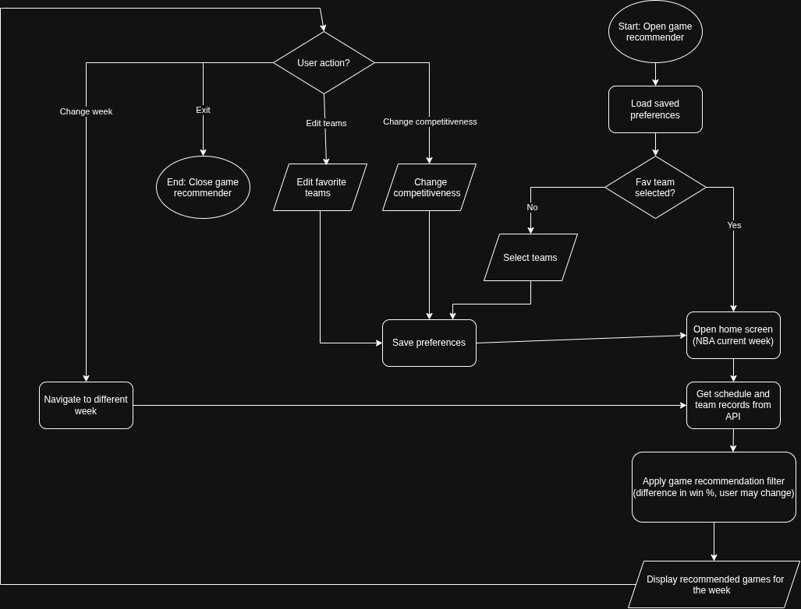

# NBA Game Finder

## Project Goal

NBA Game Finder is a Java application that helps basketball fans discover upcoming competitive games involving their favorite NBA teams. It uses current team records and NBA schedules to recommend games worth watching.

## MVP Scope

- Select favorite NBA teams on first launch and edit them later.
- Fetch NBA schedules and current team standings through an API.
- Show recommended upcoming games for the current week, with navigation to future weeks.
- Recommend a game involving at least one favorite team when the teams' winning percentages differ by no more than the selected threshold (10 percentage points by default).
- Always recommend games when **both teams** are selected favorites, even if their records are different.
- Let users adjust the competitiveness threshold or turn off the competitiveness filter to see **all games involving at least one selected team**.
- Save favorite-team and filter preferences locally.

## Future Plans (V2.0+)

- Send notifications when recommended games are about to start.
- Allow users to select their favorite NBA players and search for games where they play.
- Let users bookmark games and build a personal watchlist.

## Tech Stack

**Programming Language**
- Java

**Libraries and Tools**
- Java Swing — graphical user interface
- Java HttpClient — HTTP API requests
- Gson — JSON parsing
- VS Code — development and debugging
- Git/GitHub — version control

**Data Storage**
- Local `.properties` file for favorite teams and filter settings
- No database required for the MVP

**External Data Source**
- API Ninjas NBA API (free tier), accessed with HTTP GET requests for schedules and standings

## Project Documentation

- [Eisenhower Matrix](docs/eisenhower-matrix.md) ([completed PDF](docs/MVPEisenhower.pdf), uploaded)
- System Flowchart (PNG): `docs/SystemDiagram.png` (upload your original export)
- Editable flowchart source: `docs/SystemDiagram.drawio` (export the original from draw.io and upload)

### System Flowchart

## Project Structure

- `src/` — Java source code (to be added during development)
- `tests/` — tests (to be added during development)
- `docs/` — planning documents and system diagram

## Development Plan

The work will follow separate Git commits for these milestones:

1. Set up the Java project and Git repository.
2. Create team and game classes.
3. Implement and test recommendation logic.
4. Connect to the NBA standings API.
5. Connect to the NBA schedule API.
6. Build the team-selection interface.
7. Create the weekly recommended-games display.
8. Add adjustable competitiveness settings.
9. Save preferences and test the complete application.

> This repository is currently in the planning/setup phase; the application has not been implemented yet.
